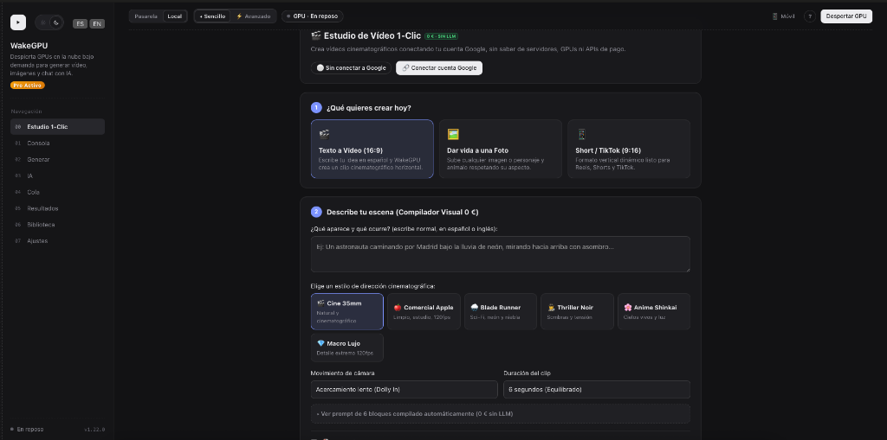
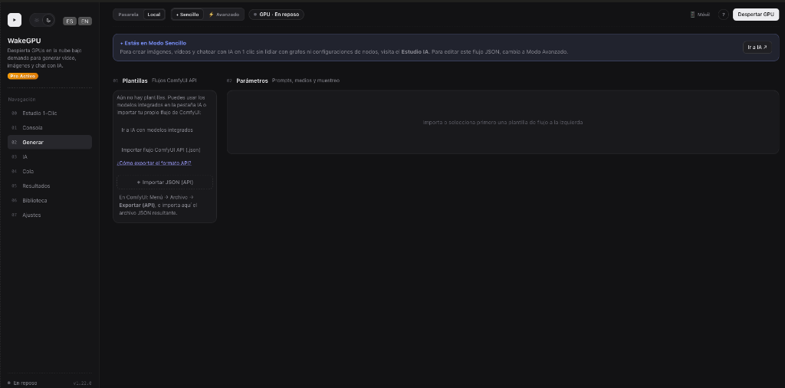
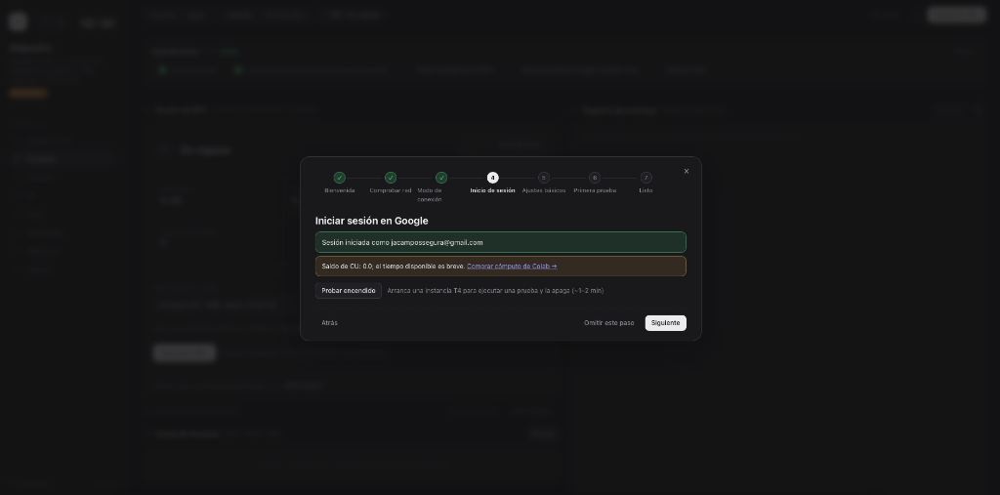

# WakeGPU

**Despierta GPUs en Google Colab bajo demanda para vídeo, imagen y programación. Cero gasto fantasma en reposo.**
A desktop workbench that wakes a Colab GPU on demand for video/image generation (ComfyUI) and coding LLMs (Cursor / VS Code) — then shuts it down when idle to save Compute Units.

[Web Oficial](https://wakegpu.com) · [Documentación](https://wakegpu.com/docs.html) · [Descargas](https://github.com/devexsolutions/wakegpu/releases/latest) · [English](#english)

Proyecto mantenido por: [a3974892-cmd](https://github.com/a3974892-cmd)

---

## 📸 Capturas de Pantalla

### 🎬 Estudio de Vídeo 1-Clic (0 € · Sin LLMs de pago)
> Diseñado para empezar en 3 clics sin conocimientos de infraestructura: conecta Google, escribe tu idea en lenguaje normal, elige un estilo cinematográfico (Muse / Wan 2.1) y deja que WakeGPU compile el prompt, despierte la GPU y la apague automáticamente al terminar.



### ⚡ Espacio de Generación Avanzado y Flujos ComfyUI


### 🔗 Conexión Directa a Google Colab


---

## Capacidades Principales

- **Estudio 1-Clic & Compilador Visual (0 €)**: Crea prompts cinematográficos de 6 bloques (estilo Muse / Wan 2.1, Apple Don't Blink, Blade Runner, Fincher, Anime) sin APIs ni LLMs de pago.
- **Control Inteligente de GPU**: Enciende / detiene / prolonga sesiones de GPU en Colab (T4 / L4 / A100 / H100) con Guardián Zero-Waste para autoapagado en inactividad (ahorro de hasta un 70% de CU).
- **Multiplataforma Nativo**: Disponible para **macOS (Apple Silicon e Intel)** mediante Cocoa/WebKit nativo y para **Windows 10/11** con WebView2.
- **Generación de Vídeo & Automatización**: Compatible con flujos ComfyUI (Wan 2.1, Hunyuan, CogVideoX), escalado Auto-HD desatendido y compatibilidad con pipelines automatizados de canales Faceless con n8n y FFmpeg.
- **Proxy Local OpenAI para Cursor & VS Code**: Endpoint local `/v1/chat/completions` para conectar extensiones de desarrollo (Cursor, Continue.dev) a modelos de código como Qwen 2.5 Coder corriendo en tu GPU.
- **Control Remoto Móvil PWA**: Escanea un código QR desde iPhone o Android para supervisar renders y pausar o apagar la GPU desde el sofá.
- **100% Gratuito y Open Source**: Publicado bajo Licencia MIT, sin cuotas mensuales ni suscripciones de pago.

---

## 📥 Descargas (macOS y Windows)

Descarga la última versión lista para usar desde **[GitHub Releases](https://github.com/devexsolutions/wakegpu/releases/latest)**:
- **macOS (Apple Silicon & Intel):** `WakeGPU-x.y.z-macos.zip` (extrae `WakeGPU.app` y muévelo a Aplicaciones).
- **Windows 10 / 11:** `WakeGPU-x.y.z.exe` (ejecutable portátil único, sin instalación).

## ¿Qué necesitas para empezar?

| | Modo Pasarela (VPS) | Modo Local Directo |
|---|---|---|
| **Cómputo en Colab** | T4 gratuita (0 CU) o Colab Pro / Pay As You Go | T4 gratuita (0 CU) o Colab Pro / Pay As You Go |
| **Servidor** | Un VPS con `comfy-colab-kit` desplegado | **No necesitas servidor** |
| **Configuración** | URL de pasarela + token | Iniciar sesión con Google dentro de la app |

Las funciones mejoradas de la pasarela (selección de GPU, biblioteca de modelos/plugins, pestaña IA) requieren aplicar los parches en [gateway/](gateway/README.md).

### ⚠️ Nota sobre el Modo Local
El modo local se conecta directamente desde tu equipo usando tu cuenta de Google. Para equipos de trabajo compartidos o sesiones continuas prolongadas, se recomienda el Modo Pasarela (VPS).

---

## Modelos y Licencias

Los modelos disponibles en la pestaña IA pertenecen a terceros; al utilizarlos debes respetar sus respectivas licencias:

| Modelo | Origen | Licencia |
|---|---|---|
| Huihui-Qwen3.8-27B-abliterated (Q8_0) | [huihui-ai](https://huggingface.co/huihui-ai/Huihui-Qwen3.8-27B-abliterated-GGUF) | Apache-2.0 |
| RealVisXL V5.0 | [SG161222](https://huggingface.co/SG161222/RealVisXL_V5.0) | CreativeML OpenRAIL++-M |
| Chroma1-HD | [lodestones](https://huggingface.co/lodestones/Chroma1-HD) | Apache-2.0 |
| MiniMax H3 | [Comfy-Org](https://huggingface.co/Comfy-Org/MiniMax-H3) | MiniMax H3 Community License |

> Respeta las leyes aplicables, las licencias de los modelos y los [Términos de Uso de Google Colab](https://research.google.com/colaboratory/faq.html).

---

## Compilar desde el código fuente

Requiere Go 1.23+ (con soporte de compilación cruzada en macOS / Linux):

```bash
# macOS (genera WakeGPU.app y dist/WakeGPU-x.y.z-macos.zip)
./build_app.sh

# Windows (genera WakeGPU.exe)
GOOS=windows GOARCH=amd64 CGO_ENABLED=0 go build -trimpath -ldflags "-s -w -H windowsgui" -o WakeGPU.exe .
```

## Estructura del proyecto

```text
*.go            Aplicación de escritorio (servidor HTTP local + ventana nativa Cocoa / WebView2)
ui/             Interfaz web integrada (HTML / CSS / JS, embebida en el binario)
kit/            Kit de arranque para Colab (basado en comfy-colab-kit, MIT) y perfiles integrados
gateway/        Parches y scripts para el modo pasarela VPS
docs/           Guías y capturas de pantalla
web/            Landing page y documentación estática (wakegpu.com)
```

## Agradecimientos

- [comfy-colab-kit](https://github.com/FireTable/comfy-colab-kit) (FireTable, MIT) — Pasarela base y kit de arranque Colab
- [ComfyUI](https://github.com/comfyanonymous/ComfyUI), [Ollama](https://github.com/ollama/ollama), [go-webview2](https://github.com/jchv/go-webview2)

Este proyecto no está afiliado con Google ni con Comfy Org.

---

## English

**WakeGPU** is a native macOS and Windows app that wakes a Google Colab GPU when you need it, runs ComfyUI workflows (video, image) and local LLM chat on it, downloads the results, and shuts the GPU down when idle.

- **Zero-Waste Guardian**: Stops paying for idle compute units by automatically putting the GPU to sleep after tasks finish.
- **Local OpenAI Proxy**: Connect VS Code, Cursor or Continue.dev directly to coding LLMs running on your Colab GPU.
- **Mobile PWA Remote**: Scan a QR code from iOS or Android to follow progress and stop the GPU remotely.
- **100% Free & Open Source**: Full capabilities included under the MIT License.

Website: [wakegpu.com](https://wakegpu.com)

MIT License. Derived in part from comfy-colab-kit (MIT, © FireTable). Not affiliated with Google or Comfy Org.
